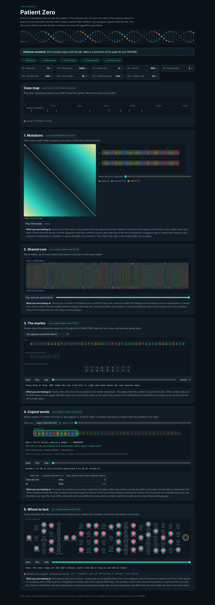

# Assignment 4. Patient Zero

Student ID: 253798
Name: Bekzat Kuatbekov
Group: SE-2511

This file is the report. How to start: `START_HERE.md`. The task: `docs/Assignment4.pdf`.

## Program output

The 9 lines my program prints on my data (`java -cp out Main`):

    Mutations: 75
    Shared core: 1005
    Marker hits: 8
    First hit: 966
    Border length: 3
    Shared words: 429
    Tests needed: 36
    Cheapest testing: 146
    Longest chain: 25

The marker is `CTTGGACTT`. The lab console shows a green tick for all 9 lines. `java tools/Check.java` shows all three examples right.

My outbreak report (a screenshot of `output/outbreak.html`):

## Questions

**Mission 1. What does the cell d[i][j] of your table mean, and how is it computed from other cells?**

d[i][j] is the smallest number of changes (replace, insert, delete one letter) that turn the first i letters of A into the first j letters of B. The first row is d[0][j] = j (insert j letters) and the first column is d[i][0] = i (delete i letters). For other cells I take the minimum of three ways: the diagonal d[i-1][j-1] plus 0 if A[i-1] = B[j-1] and plus 1 if the letters differ (replace), the top cell d[i-1][j] + 1 (delete a letter of A), and the left cell d[i][j-1] + 1 (insert a letter of B). The answer is in the last cell d[n][m].

**Mission 2. How is the longest common subsequence different from the longest common substring? My Shared core is bigger than the number of letters that are the same at the same place: why?**

A substring must be a continuous piece in both strains, a subsequence can skip letters, it only has to keep the order. So the LCS is at least as long as the longest common substring, usually much longer. My Shared core (1005) is bigger than the number of positions where A and B have the same letter at the same index, because the new strain has insertions and deletions: the letters are shifted, and the LCS can still match a letter of A with a letter of B at a different position, as long as the order is kept.

**Mission 3. What does the prefix function tell you, and why does the pointer in the text never go back in KMP? What is the Border length of my marker and what does it mean?**

pi[i] is the length of the longest proper prefix of marker[0..i] that is also a suffix of marker[0..i]. It tells how much of the matched part is still useful after a mismatch. In KMP, when the marker letter k does not match the text letter, I do not go back in the text: I only set k = pi[k-1], because the last pi[k-1] letters of the text are already known to be equal to the beginning of the marker. So the text pointer only grows and the search is O(n + m). After a full match I also use k = pi[m-1], so that overlapping matches are found. My marker is CTTGGACTT, its prefix function is [0,0,0,0,0,0,1,2,3], so the Border length is 3: the marker begins and ends with CTT. This means two occurrences of the marker can overlap by 3 letters.

**Mission 4. Why must you compare the letters after the hashes are equal? What happens to the cost of Rabin-Karp if many windows have the same hash?**

Different words can have the same hash (a collision), because there are many more words than hash values. Equal hashes only mean "maybe equal", so without comparing the letters I could count a word that is not in B. If I use a very small MOD (7 or 101) the answer stays 429 only because of the comparison. When many windows have the same hash, every such window costs O(k) letter comparisons, so the time grows from O(n + m) (expected, with few collisions) to O(n*k) in the worst case, like the naive search.

**Mission 5. What are the two states of a person in your DP, and how do you get the answer for a person from its children? Why does a greedy "test the person with most links first" not always give the cheapest answer?**

For every person v I keep two numbers for the subtree of v: yes[v], the cheapest cost when v is tested, and no[v], the cheapest cost when v is not tested. yes[v] = cost[v] + sum over children c of min(yes[c], no[c]) (v covers its links, children are free). no[v] = sum over children of yes[c] (if v is not tested, every child must be tested, otherwise the link v-c is not covered). The answer is min(yes[0], no[0]); to find who is tested I walk down from the root with the same rule. Greedy "most links first" looks only at the number of links and ignores the costs and the shape of the tree: for example, a central person with a very high cost and many neighbours with cost 1 is cheaper to skip, testing the neighbours instead. Also, a local choice can force expensive tests later, the DP looks at both cases for every person.

## AI use

Tool: Claude. Used as a coding assistant to help draft code for Missions, debug and run checks, and structure the initial README draft. I read all the code and the answers above, I understand them, and I can explain every algorithm myself. 

## Timing (Mission 7)

Milliseconds, average of 3 runs, from `java -cp out Bench`.

| test | size | time |
|---|---|---|
| naive search | 20 000 / 40 000 / 80 000 | 70.6 / 130.9 / 258.3 ms |
| KMP | 20 000 / 40 000 / 80 000 | 5.9 / 3.6 / 0.7 ms |
| edit distance | 500 / 1000 / 2000 / 4000 | 16.7 / 14.6 / 42.8 / 167.6 ms |

What do the numbers say about how the time grows? The naive search doubles when the text doubles (70 -> 131 -> 258 ms), because for each start it compares up to 2000 letters: O(n*m). KMP stays at a few milliseconds and does not grow in a visible way: O(n + m), and the first runs are only slower because the JVM is still warming up. Edit distance grows about 4 times when the length doubles (42.8 -> 167.6 ms for 2000 -> 4000), which is quadratic, O(n*m); the first two numbers are small and noisy for the same JIT reason.

## Complexity

n is the length of the text (or of a strain), m the length of the pattern, k the length of the window, v the number of people. Fill in every algorithm you wrote.

| algorithm | time | space | assumptions |
|---|---|---|---|
| Edit distance | O(n*m) | O(n*m) | full table (n+1) x (m+1), two nested loops, O(1) per cell; with two rows only, space would be O(m) |
| LCS | O(n*m) | O(n*m) | same table size and loops as edit distance |
| Prefix function and KMP | O(n + m) | O(m) (+ O(number of hits) for the result) | each step either moves i forward or decreases k, and k can decrease at most as many times as it grew (amortized) |
| Rabin-Karp (shared words) | O(n + m) expected, O(n*k) worst case | O(m) | rolling hash updates in O(1); the worst case is when many windows have equal hashes and each needs a comparison of k letters; HashMap with O(1) average lookup |
| Tree DP | O(v) | O(v) | every person is visited once, plus the recursion depth up to O(v) |

## Before you submit

- The four files in `data` and the screenshot `output/outbreak.png` are in the repository.
- `java tools/Check.java` shows all examples right.
- This README is filled in, the program output and the section AI use included.
- The work is pushed to main (at least one commit per mission) and the repository is public.
- The link is attached in Moodle.
